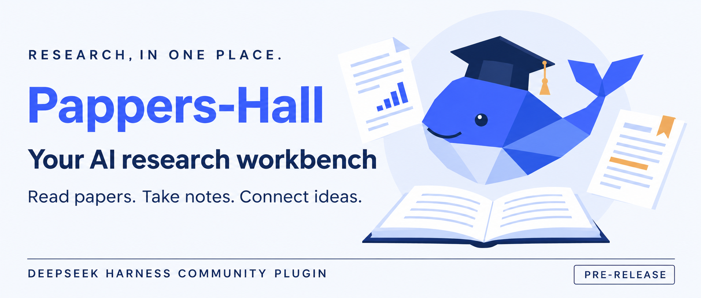
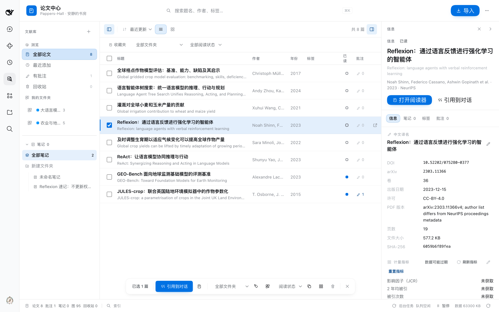
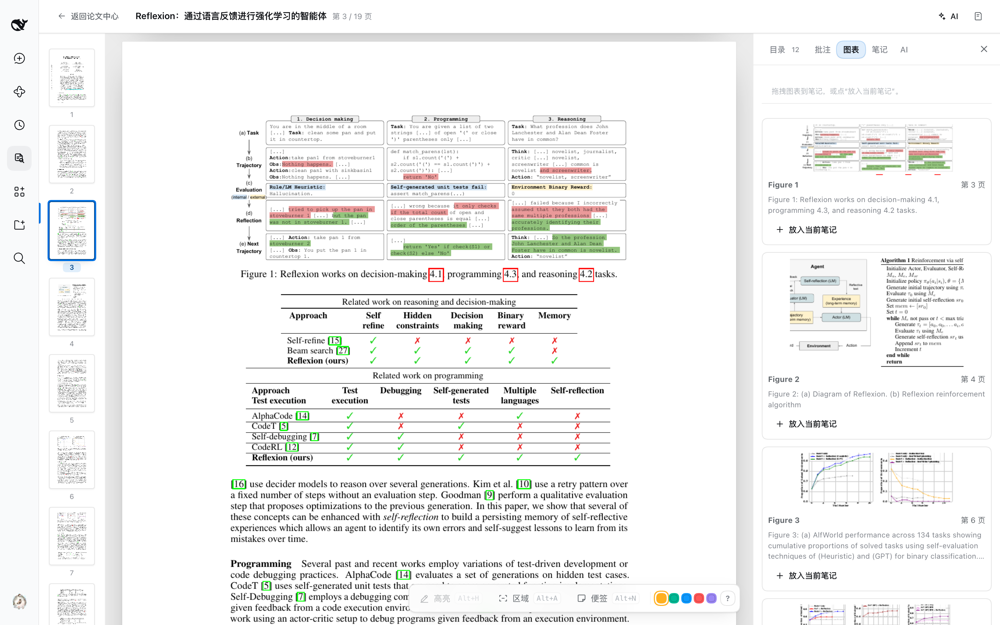
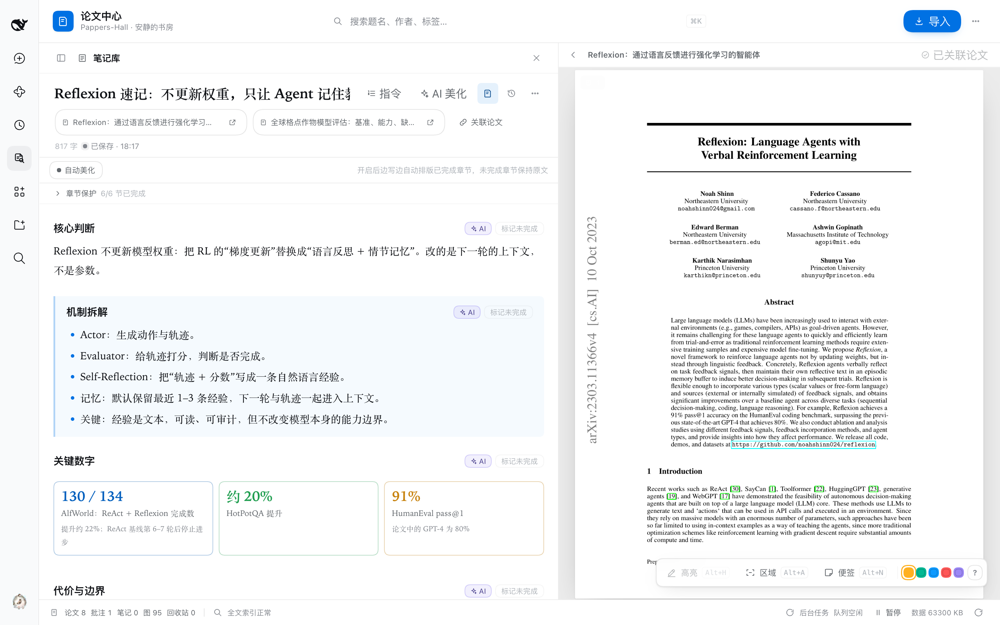
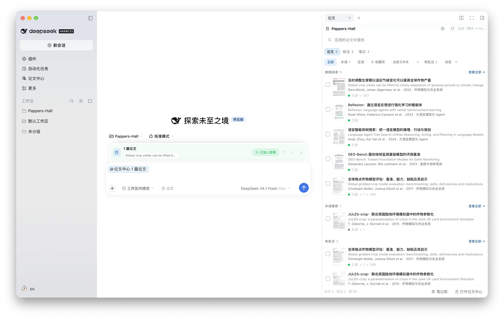

<p align="center"></p>

<p align="center"><a href="README.md">简体中文</a> · <b>English</b></p>

<h1 align="center">Read the paper. Keep the insight.</h1>

<p align="center"><b>Pappers-Hall · Your research workbench inside DeepSeek Harness</b><br>Organize papers, read closely, build notes, and bring source material into your research conversations.</p>

<p align="center">
  
  
  <a href="LICENSE"></a>
</p>

<p align="center"><a href="#workbench">The workbench</a> · <a href="#features">Product tour</a> · <a href="#start">Get started</a> · <a href="#faq">FAQ</a> · <a href="docs/press-kit/README.md">Press kit</a></p>

> **Actively developed · Pre-release.** GitHub downloads are preview builds. Screenshots show the current development instance; consult each [release's notes](https://github.com/YuZhou0311/dsh-pappers-hall/releases) for the capabilities of that package.

<br>

<a id="workbench"></a>

## One connected workbench for your research

Research moves between papers, figures, annotations, notes and questions. Pappers-Hall connects these activities inside [DeepSeek Harness](https://github.com/deepseek-ai/deepseek-harness) (DSH): open a paper, examine the evidence, write down your understanding, and bring the relevant material into an Agent conversation.

| Collect | Read | Develop | Discuss |
| :--- | :--- | :--- | :--- |
| Import and organize papers | Inspect original pages and figures | Write linked, structured notes | Ask questions with source context |

### Why research in Pappers-Hall?

| Workbench advantage | What it means for your research |
| :--- | :--- |
| **Native to DSH** | The library, reader, notes and research conversations share one environment and use your configured models and Agent capabilities. |
| **Connected to sources** | Papers, page references, figures and annotations can accompany your questions, helping you return to the original evidence. |
| **Read and write side by side** | Keep a linked paper beside your note, so you can check the source while developing your own understanding. |
| **AI formatting preserves your draft** | Original Markdown and formatted structures are stored separately. Note history lets you revisit earlier versions. |
| **Local library storage** | Papers, notes, annotations and indexes live in the plugin data directory for backup and migration. AI and web features use the services described below. |

<br>

<a id="features"></a>

## 01 / A library for your research

Import PDFs, BibTeX, RIS and CSL-JSON. Organize them with folders, human-managed tags and reading states. Search, switch between list and grid views, act on multiple papers, and restore items from the trash.

Select a paper to inspect metadata, notes, annotations and source links. Open the reader when you are ready to go deeper.

[](docs/assets/screenshots/library-light.png)

<br>

## 02 / Keep the original evidence in view

Read original PDF pages with text selection, highlights, area annotations and sticky notes. Navigate with outlines and page search. Find figures, return to their source pages, and bring them into notes or conversation references.

Translation and AI reading use the models configured in DSH. You can also inspect and read a local PDF before deciding whether to import it.

[](docs/assets/screenshots/reader-figures-light.png)

<br>

## 03 / Turn reading into your own understanding

Notes can stand alone or link to multiple papers. Read a source beside your note and record the central idea, methods, experimental conditions and your own interpretation. Find it again through the notes tree and full-text search.

The dedicated **Note Agent** can organize content into cards, tables, charts, timelines, tasks, flow diagrams and mind maps. Interactive blocks support saved state. Formatting preserves the original Markdown.

[](docs/assets/screenshots/notes-workbench-light.png)

Write a directive in a saved note, then use the editor's **Directives** action:

```text
{{figure: Figure 3}}
{{mindmap: Research question, method and limitations}}
{{compare: Conditions in which each method applies}}
{{tasks: Reading and replication checklist}}
```

Natural-language requests such as “add a figure from the paper here” also work. Paper figures come from linked papers; web sources and web images require the corresponding services. The Note Agent's tools are restricted to the current note task. See the [directive and Note Agent reference](docs/DEVELOPMENT.md#inline-directives-and-the-note-agent).

<br>

## 04 / Start the conversation with the material

Select papers, figures, annotations or notes and choose **Cite to conversation**: the material lands in the draft as one citation token that can be extended or removed with the × next to it. The source-aware reference lets the Agent read the relevant material as it works.

> Explain this paper's mechanism, applicable conditions and limitations, with references to the original evidence.

[](docs/assets/screenshots/conversation-light.png)

<p align="center"><sub>All product screenshots are actual captures of the Chinese UI in light mode at a desktop viewport and 2× resolution. Numbers inside the sample note describe its paper, not plugin performance. The conversation screenshot shows an unsent draft with the attached reference.</sub></p>

<br>

## More capabilities, when your research needs them

| Capability | Current support and requirements |
| :--- | :--- |
| **Bibliographies and citations** | Import common bibliography formats, copy or export BibTeX, and retrieve Citation Keys. |
| **Local PDF tools** | Inspect, read in batches, and view figures before importing a paper with your confirmation. |
| **Research Agent tools** | 14 public tools cover paper search, passages, figures, library management, annotations, translation and notes. |
| **Interactive note blocks** | Sortable tables, comparisons, forms, multi-series charts, task state and image galleries, with saved interaction state. |
| **OCR and semantic search** | Require optional components to be installed and enabled. Missing capabilities are reported explicitly or use the available basic search path. OCR uses the fixed PP-OCRv6 models and layout analysis uses PP-DocLayout-S. |
| **Chinese and English interface** | Both interface languages are available. This README uses the same light-mode screenshots as the Chinese edition. |

<a id="start"></a>

## Get started

### 1. Prepare your environment

- **DeepSeek Harness:** the declared compatibility range is `>=0.2.2-rc.2 <0.3.0`; the verified host version is `0.2.2-rc.2`. DSH itself is a developer preview.
- **Node.js ≥24**, plus Poppler's `pdfinfo`, `pdftotext` and `pdftoppm` available to DSH.
- Configure a suitable model in DSH before using translation, AI reading or note formatting. Add OCR, embeddings and image-capable models as needed.

### Getting started guide

The first visit to the paper centre opens a ~2-minute guide that walks through the four daily actions (read, annotate, note, cite) and brings the two setup steps into the flow:

1. **Local component**: install PyMuPDF + PP-OCRv6 + PP-DocLayout-S right in the guide (or later under Settings → Capabilities)
2. **Sample paper**: a bundled 3-page PDF — two text pages (figure and table) plus one rasterised page that only OCR can read

Skipping the guide stops it from opening again; replay it from the toolbar's More menu or the "Getting started" section in Settings.

### Optional local component (recommended)

Settings → Capabilities → **Local component (PDF · OCR · layout)** installs three capabilities in one click:

| Capability | Component | Notes |
|---|---|---|
| PDF extraction | **PyMuPDF** | Replaces the Poppler CLI: text blocks, word boxes, images and rendering in one pass; falls back to Poppler when absent |
| Scanned pages | **PP-OCRv6** (det + rec, tiny) | Recognises pages without a text layer; results feed search, the reader text layer, abstract and outline; about 4 s per page (≈1.5 min for a 23-page paper) |
| Layout analysis | **PP-DocLayout-S** | Labels titles, body text, figures, tables, headers and footers to correct paragraph roles |

- The models are **fixed** — no picker: they are downloaded once into the local data directory and verified by SHA-256
- Everything runs offline; no document content is uploaded
- PyMuPDF is **AGPL-3.0** (Artifex): it is installed by the user into a private local Python environment and never bundled with the plugin
- Uninstalling returns PDF extraction to Poppler; already stored OCR text is kept

On macOS, install Poppler with:

```sh
brew install poppler
```

On other platforms, install the corresponding Poppler command-line tools and make sure DSH can find them. See [configuration](docs/DEVELOPMENT.md#configuration) for custom executable paths.

### 2. Install a pre-release package

Download a `.tgz` from [GitHub Releases](https://github.com/YuZhou0311/dsh-pappers-hall/releases), selecting a **Pre-release** build. Quit DSH Desktop completely, install from your download directory, then reopen DSH. This example uses the published `0.24.23` package; substitute your downloaded filename:

```sh
dsh plugin --profile desktop add ./dsh-pappers-hall-0.24.23.tgz
```

For DSH Web, substitute your Web profile and restart that instance. If `dsh` is not available in your terminal, configure the command through the DSH Desktop menu first.

<details>
<summary><b>Install from source</b></summary>

```sh
git clone https://github.com/YuZhou0311/dsh-pappers-hall.git
cd dsh-pappers-hall
npm ci
npm run build
dsh plugin --profile desktop add "link:$PWD"
```

Rebuild after updating, then reload the plugin or restart the page as required by the host. Configuration, tool details and verification commands are documented in [DEVELOPMENT.md](docs/DEVELOPMENT.md).

</details>

### 3. Start with one paper

1. Open **Paper Center** from the DSH sidebar and import a PDF.
2. Open the reader, find a passage or figure, and add an annotation.
3. Create a note, link the paper, and write beside the original page.
4. Cite the material into a conversation and continue exploring with a configured model.

<br>

<a id="faq"></a>

## Frequently asked questions

<details>
<summary><b>Is this a standalone app? Does it only work with DeepSeek models?</b></summary>

Pappers-Hall is a DSH community plugin and requires a compatible DeepSeek Harness host. AI features use models configured in DSH that meet each feature's requirements. Working with images also requires an image-capable model.

</details>

<details>
<summary><b>Where are my papers and notes stored?</b></summary>

The default location is `$DSH_HOME/pappers-hall/`, configurable via `dataDir`. It contains the database, papers, figures, indexes and related assets. Back up the entire directory to preserve your library.

Local storage does not make AI fully offline: translation, question answering and note formatting send relevant content to your configured DSH model services. Web search and web-image features also contact their providers. Choose services and features appropriate for your material.

</details>

<details>
<summary><b>Can I use it without AI? What does it cost?</b></summary>

The plugin is open source under the MIT license. With the required local PDF tools installed, you can organize, read and annotate papers and manage notes. AI features use your own model service account and quota. The plugin includes no model keys or free credits.

</details>

<details>
<summary><b>Will AI formatting overwrite my notes?</b></summary>

Formatted structures and original Markdown are stored separately. You can revisit note history or clear the formatted structure while keeping the draft. The Note Agent focuses on the current note; paper tags remain under your control.

</details>

<details>
<summary><b>What are the current limitations?</b></summary>

Stability and compatibility are still being refined during the preview. Scanned PDFs require OCR; semantic embeddings, translation and visual AI depend on their respective components or models. Unusual PDF layouts can produce imperfect figure crops, so check the full page when needed. Verify AI-generated summaries and research conclusions against their sources.

</details>

<br>

## Help shape the workbench

Bring a real reading workflow, report a missing capability, or share a reproducible problem.

**[Issues](https://github.com/YuZhou0311/dsh-pappers-hall/issues) · [Discussions](https://github.com/YuZhou0311/dsh-pappers-hall/discussions) · [Changelog](CHANGELOG.md) · [Contributing](CONTRIBUTING.md) · [Security](SECURITY.md) · [Press kit](docs/press-kit/README.md)**

If Pappers-Hall helps your research, star the repository to follow its progress or share it with others who have similar workflows. For research attribution, use the [citation metadata](CITATION.cff) and include the version you used.

Thanks to [DeepSeek Harness](https://github.com/deepseek-ai/deepseek-harness) for its plugin platform. README presentation references: [dsh-media-desk](https://github.com/woniuniuniu/dsh-media-desk), [DS Bot](https://github.com/Fei2411/DS-Bot), and [Huashu Design](https://github.com/alchaincyf/huashu-design). Illustrations were generated for this project; [source and asset notes](docs/press-kit/SOURCES.md) accompany the kit.

---

<p align="center"><br><b>Research, in one place.</b><br><sub>MIT · An independent community project. Not affiliated with, endorsed or sponsored by DeepSeek.</sub></p>
