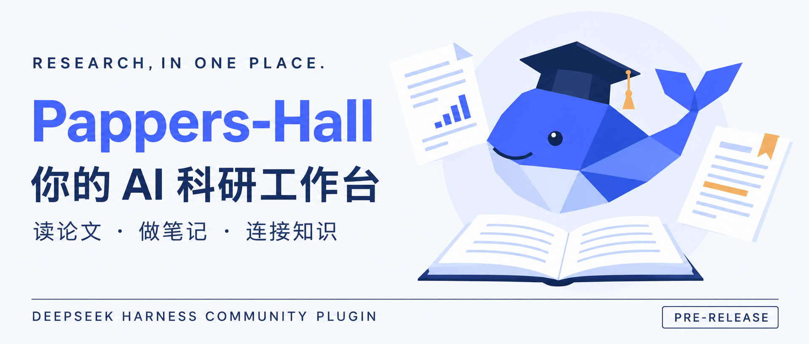
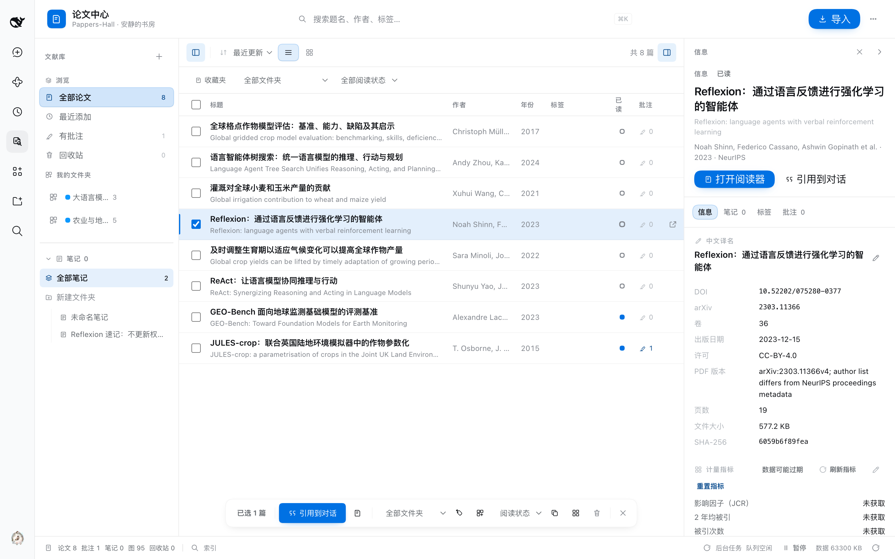
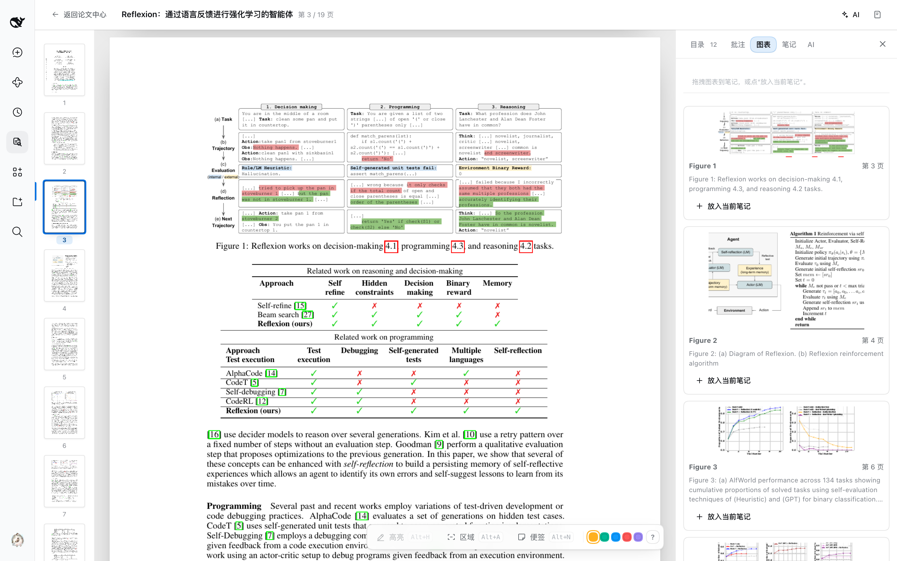
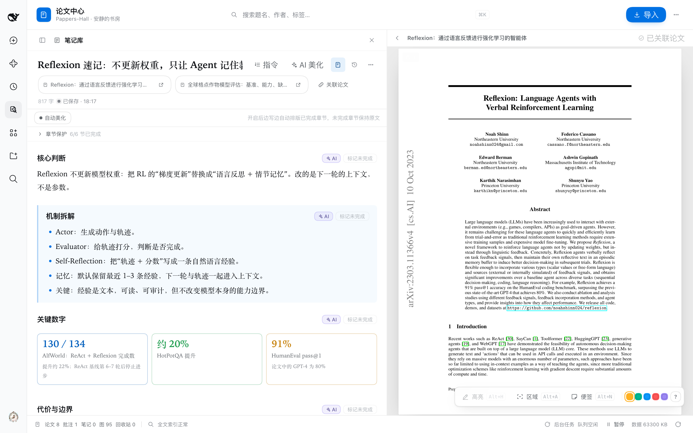
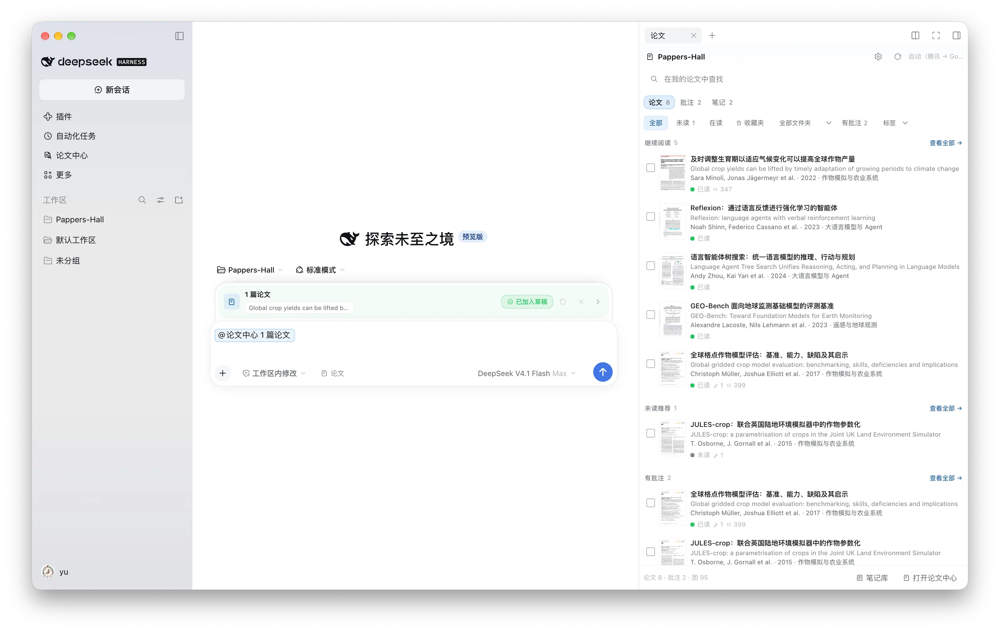

<p align="center">
  
</p>

<p align="center"><b>简体中文</b> · <a href="README.en.md">English</a></p>

<h1 align="center">把论文读进去，把知识留下来。</h1>

<p align="center">
  <b>Pappers-Hall · DeepSeek Harness 里的 AI 科研工作台</b><br>
  管理论文、精读原文、积累笔记，把有出处的材料带进每一次研究对话。
</p>

<p align="center">
  
  
  <a href="LICENSE"></a>
</p>

<p align="center">
  <a href="#workbench">认识工作台</a> ·
  <a href="#features">功能实景</a> ·
  <a href="#start">安装试用</a> ·
  <a href="#faq">常见问题</a> ·
  <a href="docs/press-kit/README.md">宣传素材</a>
</p>

> **正在开发，欢迎参与预发布体验。** GitHub Releases 中提供的是 **Pre-release**，功能与界面会继续调整。本文展示当前开发版本；下载包的能力以对应 [Release 说明](https://github.com/YuZhou0311/dsh-pappers-hall/releases) 为准。

<br>

<a id="workbench"></a>

## 你的研究，需要一张连贯的工作台

读一篇论文时，我们会在原文、图表、摘录、笔记和 AI 对话之间来回切换。Pappers-Hall 把这些环节接在一起：**论文有位置，理解有记录，讨论有依据。**

它作为原生插件融入 [DeepSeek Harness](https://github.com/deepseek-ai/deepseek-harness)（DSH）。从侧栏进入论文中心，在阅读器里定位原文，在旁边整理想法，再把论文、图表、批注或笔记引用到 DSH 对话里。资料与思考由此形成一条可以继续深入的研究路径。

| 收集材料 | 深入阅读 | 沉淀理解 | 继续研究 |
| :--- | :--- | :--- | :--- |
| 导入 PDF 与书目，按主题组织 | 原文、目录、批注与图表一起看 | 边读边写，整理成结构化笔记 | 带着具体来源向 Agent 提问 |

### 为什么放在 Pappers-Hall 里做研究

| 工作台优势 | 对研究意味着什么 |
| :--- | :--- |
| **原生接入 DSH** | 论文库、笔记与研究对话在同一环境中衔接，复用你已经配置的模型与 Agent 能力。 |
| **材料可以追溯** | 论文、页码、图表和批注能作为来源进入对话，方便回到原文核对。 |
| **阅读与写作并排** | 笔记关联论文，原文就在旁边，提炼观点时随时对照。 |
| **AI 排版保留原稿** | 原始 Markdown 与美化结构分开保存；笔记支持历史版本，整理表达时保留自己的文字。 |
| **资料保存在本地** | 论文、笔记、批注与索引由插件数据目录管理，便于备份和迁移。AI 与联网功能的数据流向见下方说明。 |

<br>

<a id="features"></a>

## 01 / 把散落的文献，整理成研究资料库

导入本地 **PDF、BibTeX、RIS、CSL-JSON**，按文件夹、标签和阅读状态整理。列表与网格视图、搜索、批量操作、回收站与恢复，让日常积累有条理。

选中论文即可查看元信息、关联笔记、批注与来源链接；需要深入时，直接进入阅读器。标签由你管理，Agent 不会替你增删。

<p align="center">
  <a href="docs/assets/screenshots/library-light.png"></a>
</p>

<br>

## 02 / 原文、图表与批注，都在阅读现场

在原始 PDF 页面上阅读与选词，高亮重点、框选区域、添加便签。目录和页内搜索帮助定位，图表列表把论文里的证据放到手边。

图表可定位回原文、拖入笔记或用于对话引用；翻译与 AI 辅助阅读使用 DSH 中配置的模型。也支持**先读本地 PDF，再决定是否导入**，临时查阅不必先建立条目。

<p align="center">
  <a href="docs/assets/screenshots/reader-figures-light.png"></a>
</p>

<br>

## 03 / 一边读，一边长出自己的知识

笔记可以独立成篇，也可以关联多篇论文。写作时把原文放在旁边，记录核心结论、方法拆解、实验条件与自己的判断；以后通过笔记树和全文搜索继续找到它们。

**独立笔记 Agent** 可以把内容整理成重点卡片、数据表、图表、时间线、任务清单、流程图或思维导图。原始 Markdown 与排版结果分别保存，完成的章节还可以单独管理。

<p align="center">
  <a href="docs/assets/screenshots/notes-workbench-light.png"></a>
</p>

在笔记中写下指令，再使用工具栏的「指令」处理，例如：

```text
{{figure: Figure 3}}
{{mindmap: 这篇论文的研究问题、方法与局限}}
{{compare: 比较两种方法的适用条件}}
{{tasks: 下一轮阅读与复现实验清单}}
```

也可以写「这里加一张论文图」这样的自然语言请求。论文配图从已关联论文中查找；网页配图与网页资料检索需要相应联网能力。笔记 Agent 的工具范围限于当前笔记任务，详细指令与边界见 [技术说明](docs/DEVELOPMENT.md#inline-directives-and-the-note-agent)。

<br>

## 04 / 让 AI 从你正在研究的材料出发

从论文中心或对话侧栏选取材料，点击「引用到对话」，材料会作为一个引用标签直接进入草稿，可以继续叠加，也可以点标签旁的 × 取消。材料引用会把来源上下文交给 Agent，方便它继续读取对应论文、段落、图表、批注与笔记。

你可以这样开启一轮研究：

> 请根据这篇论文梳理核心机制、适用条件与局限，并给出可追溯的原文依据。

<p align="center">
  <a href="docs/assets/screenshots/conversation-light.png"></a>
</p>

<p align="center"><sub>以上均为浅色模式实拍：桌面视口，2× 清晰度。示例笔记中的数字属于论文阅读内容，不代表插件性能；最后一张展示发送前的引用草稿。</sub></p>

<br>

## 更多能力，按研究需要开启

| 能力 | 当前支持与条件 |
| :--- | :--- |
| **书目与引用** | 导入常见书目格式，复制或导出 BibTeX、获取 Citation Key。 |
| **本地 PDF 工具** | 检查、分批读取、查看图表；确认后才导入资料库。 |
| **研究 Agent 工具** | 14 个公开工具覆盖论文检索、片段与图表读取、资料管理、批注、翻译及笔记操作。 |
| **交互式笔记块** | 可排序表格、比较表、表单、多序列图表、任务状态和图片画廊；交互状态可保存。 |
| **OCR 与语义检索** | 需安装并启用可选组件；缺失时明确显示不可用或使用基础检索。OCR 使用固定模型 PP-OCRv6，版面分析使用 PP-DocLayout-S。 |
| **中文与英文界面** | 提供中英文界面文案；本文的产品截图统一使用浅色模式。 |

<a id="start"></a>

## 开始你的第一轮研究

### 1. 准备环境

- **DeepSeek Harness**：当前声明兼容 `>=0.2.2-rc.2 <0.3.0`，已核验的宿主版本为 `0.2.2-rc.2`。DSH 本身仍处于开发预览阶段。
- **Node.js ≥ 24**，以及可调用的 Poppler 工具：`pdfinfo`、`pdftotext`、`pdftoppm`。
- 使用翻译、AI 阅读与笔记排版前，在 DSH 中配置可用模型；OCR、嵌入与视觉能力另按需要配置。

### 文献检索：关键词与语义

论文中心上方的搜索框同时支持两种检索方式，筛选行右侧有「混合 / 语义」开关：

- **混合（默认）**：全文（FTS5）+ 子串关键词优先，语义相近的论文补充在后面
- **语义**：用本地嵌入模型（paraphrase-multilingual-MiniLM-L12-v2）按语义排序，每行显示相似度分数，并用摘要开头做片段

语义检索需要先在「设置 → 能力与模型 → 向量检索」安装嵌入组件并建立索引；未就绪时开关旁会直接给出原因和入口。首次查询要加载模型（约 12 秒），之后单次约 50 毫秒。

### 首次使用引导

第一次打开论文中心，左侧会出现一张「开始使用」任务卡，七件事都对应真实操作，**勾选状态从文献库里推导**，不是让你自己点确认：

| 任务 | 怎么打勾 |
|---|---|
| 安装本地组件 | 装好 PyMuPDF + PP-OCRv6 + PP-DocLayout-S |
| 安装向量检索（语义搜索） | 装好本地嵌入模型并建好索引，约 1 GB；任务卡里直接点「安装」会自动装组件再建索引 |
| 导入示例论文 | 导入内置的 3 页示例 PDF |
| 阅读示例论文 | 真的打开读过（`last_read_at`） |
| 高亮一段文字 | 在示例论文里拖选并高亮 |
| 高亮写成笔记 | 笔记与示例论文绑定 |
| 引用到对话 | 引用标签进入草稿 |

卡片里点「安装向量检索」，它会先装嵌入组件（显示安装进度）再自动建索引（显示索引进度），完成后语义搜索立即可用。卡片里点「导入示例论文」会自动打开阅读器，阅读器左下角出现提示条，随着你完成高亮 → 笔记 → 引用，提示条一步步前进；回到论文中心时任务卡自动打完勾。全部完成后卡片显示 100% 和「完成引导」。

想重看：工具栏「更多 → 使用引导」，或设置里的「使用引导」（已完成的勾会保留，因为状态来自文献库本身）。

```
论文中心
├─ 开始使用  4/7  ▓▓▓░░░░░
│  ✓ 安装本地组件
│  ✓ 安装向量检索（语义搜索）
│  ✓ 导入示例论文
│  ○ 阅读示例论文        [打开]
│  ○ 高亮一段文字        [高亮]
│  ○ 高亮写成笔记        [笔记]
│  ○ 引用到对话          [引用]
```

### 本地增强组件（可选，推荐）

设置 → 能力与模型 → **本地增强组件（PDF · OCR · 版面）**，一次安装提供三项能力：

| 能力 | 组件 | 说明 |
|---|---|---|
| PDF 解析 | **PyMuPDF** | 替代 Poppler 命令行：文本块、词框、图片、页面渲染一次完成；未安装时自动回到 Poppler |
| 扫描页识别 | **PP-OCRv6**（det + rec，tiny） | 无文字层页面按需识别，结果进入搜索、阅读器文本层、摘要与目录；单页约 4 秒，整篇 23 页约 1.5 分钟 |
| 版面分析 | **PP-DocLayout-S** | 识别标题、正文、图表、表格、页眉页脚等区域，用来校正段落角色 |

- 模型**固定**，没有选择器：安装时一次性下载到本地数据目录，校验 SHA-256 后使用
- 全部离线运行，不上传任何文献内容
- PyMuPDF 采用 **AGPL-3.0**（Artifex），仅由用户安装到本机独立 Python 环境，不随插件分发；安装界面会明确提示
- 卸载后 PDF 解析自动回到 Poppler，已有 OCR 文本保留

macOS 可通过 Homebrew 安装 Poppler：

```sh
brew install poppler
```

其他环境需安装对应的 Poppler 命令行工具，并确保 DSH 能找到它们。自定义程序路径见 [配置说明](docs/DEVELOPMENT.md#configuration)。

### 2. 在 DSH 里直接安装（推荐）

打开 DSH →「插件」→ 右上角「**+ 添加插件**」，在输入框里粘贴下面任意一行，点「安装」即可，不需要下载发布包：

```
github:YuZhou0311/dsh-pappers-hall
```

也接受下面两种写法：

```
YuZhou0311/dsh-pappers-hall

https://github.com/YuZhou0311/dsh-pappers-hall
```

等价命令行安装方式：

```sh
dsh plugin --profile desktop add github:YuZhou0311/dsh-pappers-hall
```

安装完成后重新打开 DSH（或重新加载插件），左侧会出现「论文中心」入口。首次进入会看到「开始使用」任务卡，跟着它导入示例论文、安装本地组件即可。

升级到最新版：

```sh
dsh plugin --profile desktop add github:YuZhou0311/dsh-pappers-hall
```

该命令会按 GitHub 默认分支重新解析依赖；如果仍显示旧版本，先移除再安装：

```sh
dsh plugin --profile desktop remove dsh-pappers-hall
dsh plugin --profile desktop add github:YuZhou0311/dsh-pappers-hall
```

<details>
<summary><b>离线安装（下载发布包）</b></summary>

前往 [GitHub Releases](https://github.com/YuZhou0311/dsh-pappers-hall/releases) 下载 `dsh-pappers-hall-*.tgz`，完全退出 DSH 后执行：

```sh
dsh plugin --profile desktop add ./dsh-pappers-hall-0.1.0.tgz
```

文件名请替换为实际下载版本。DSH Web 请把 `desktop` 换成自己的 Web profile，并重启对应实例；命令行中没有 `dsh` 时，可先在 DSH 桌面端菜单里配置。

</details>

<details>
<summary><b>从源码运行</b></summary>

```sh
git clone https://github.com/YuZhou0311/dsh-pappers-hall.git
cd dsh-pappers-hall
npm ci
npm run build
dsh plugin --profile desktop add "link:$PWD"
```

更新后重新构建，并按宿主要求重新加载插件或重启页面。配置、工具列表与验证命令见 [开发说明](docs/DEVELOPMENT.md)。

</details>

### 3. 从一篇论文开始

1. 在 DSH 侧栏打开「论文中心」，导入一篇 PDF。
2. 打开阅读器，定位关键段落或图表，记下一条批注。
3. 新建笔记、关联论文，在原文旁边写下自己的理解。
4. 把材料引用到对话，配置好模型后开始追问。

<br>

<a id="faq"></a>

## 你可能想先了解

<details>
<summary><b>它是独立应用吗？只能使用 DeepSeek 模型吗？</b></summary>

Pappers-Hall 是 DSH 社区插件，需要兼容的 DeepSeek Harness 宿主。AI 能力使用你在 DSH 中配置、且满足对应功能要求的模型；看图还需要模型支持图像输入。

</details>

<details>
<summary><b>我的论文和笔记存在哪里？</b></summary>

默认保存在 `$DSH_HOME/pappers-hall/`，包括数据库、论文、图表和索引等，也可通过 `dataDir` 配置位置。备份时建议保留整个数据目录。

本地存储不等于 AI 全程离线：翻译、AI 问答与笔记排版会把相关内容发送给 DSH 中配置的模型服务；网页搜索、网页配图也会访问对应服务。请按资料要求选择服务与功能。

</details>

<details>
<summary><b>不开 AI，也能使用吗？是否收费？</b></summary>

插件以 MIT 协议开源。具备必要的本地 PDF 工具后，基础文献整理、阅读、批注与笔记管理可以使用；AI 功能依赖你自己的模型服务与额度，费用由对应服务决定。插件不附带模型密钥或免费额度。

</details>

<details>
<summary><b>AI 美化会覆盖我的笔记吗？</b></summary>

美化结构与原始 Markdown 分开保存。你可以查看历史版本，或清除美化结构来保留原稿。笔记 Agent 专注当前笔记的整理，论文标签仍由用户管理。

</details>

<details>
<summary><b>当前有哪些限制？</b></summary>

预发布阶段仍在完善稳定性与兼容性。扫描版 PDF 需要 OCR；语义嵌入、翻译和看图依赖对应组件或模型。复杂论文版式的自动图表裁切可能不完整，必要时回到整页核对。AI 生成的总结与研究判断也应对照原文检查。

</details>

<br>

## 一起把科研工作台打磨好

欢迎带着真实阅读场景来试用：哪一步打断了思路、哪一张图裁切不完整、哪一种笔记表达还不够顺手，都可以成为下一次改进的起点。

**[提交问题或建议](https://github.com/YuZhou0311/dsh-pappers-hall/issues) · [使用交流](https://github.com/YuZhou0311/dsh-pappers-hall/discussions) · [查看版本变化](CHANGELOG.md) · [参与贡献](CONTRIBUTING.md) · [安全反馈](SECURITY.md)**

如果它帮助了你的研究，可以 Star 关注后续进展，也欢迎分享给有相似工作流的朋友。研究中使用本项目时，可通过 [引用信息](CITATION.cff) 注明所用版本。

品牌主视觉、透明小鲸鱼、宣传海报、分享封面、原始截图与发布文案收录于 **[宣传素材包](docs/press-kit/README.md)**。

感谢 [DeepSeek Harness](https://github.com/deepseek-ai/deepseek-harness) 提供原生插件能力；本次 README 的图文叙事参考了 [自媒体工作台](https://github.com/woniuniuniu/dsh-media-desk)、[DS Bot](https://github.com/Fei2411/DS-Bot) 和 [Huashu Design](https://github.com/alchaincyf/huashu-design)，品牌插画为本项目重新生成。截图论文来源与素材说明见 [来源记录](docs/press-kit/SOURCES.md)。

---

<p align="center">
  <br>
  <b>读论文 · 做笔记 · 连接知识</b><br>
  <sub>MIT · Pappers-Hall 是独立社区项目，与 DeepSeek 无隶属、认可或赞助关系。</sub>
</p>
