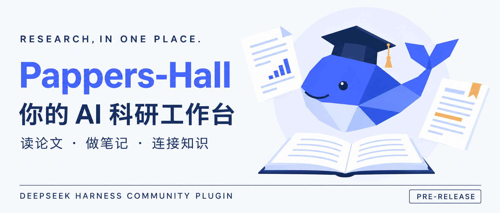
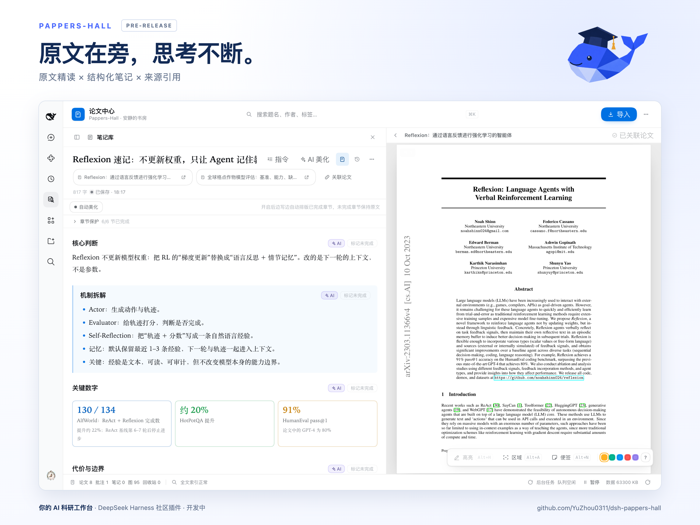

# Pappers-Hall 宣传素材包

**把论文读进去，把知识留下来。**

Pappers-Hall 是 DeepSeek Harness 里的 AI 科研工作台。本套物料以戴学士帽的多边形蓝鲸为品牌主角，把论文、图表、笔记与研究对话连成统一的视觉语言。

所有物料均使用 **开发中 / Pre-release** 的发布口径。产品界面为 Chrome 浅色模式真实截图，品牌插画使用 Codex 图片生成工具制作。

[返回产品介绍](../../README.md) · [发布文案](COPY.zh.md) · [来源与制作说明](SOURCES.md) · [图片生成提示词](IMAGE-PROMPTS.md)

下载仓库后，可在浏览器打开本目录的 **[index.html](index.html)**，集中查看全部物料；GitHub 页面会显示该 HTML 的源码。

## 直接使用的素材

| 素材 | 尺寸 | 推荐用途 |
| :--- | :--- | :--- |
| [README 开篇主视觉](../assets/brand/readme-hero.png) | 1920 × 819 | README 顶部、项目介绍、长文开篇 |
| [README 英文主视觉](../assets/brand/readme-hero-en.png) | 1920 × 819 | 英文 README、国际社区介绍 |
| [透明学士帽小鲸鱼](../assets/brand/scholar-whale.png) | 1254 × 1254，RGBA | 头像、角标、演示页、品牌署名 |
| [竖版发布海报](../assets/social/launch-poster.png) | 1086 × 1448，3:4 | 社区分享、社交图文、项目发布 |
| [横版分享封面](../assets/social/social-preview.png) | 1774 × 887，2:1 | 仓库 Social preview、文章封面、分享卡片 |
| [GitHub Social preview 上传版](../assets/social/github-social-preview.jpg) | 1774 × 887，约 271 KiB | 同一封面的 JPEG 压缩版，符合 GitHub 小于 1 MB 的要求 |
| [科研工作台实景卡片](../assets/social/workbench-card.png) | 2880 × 2160，4:3 | 功能介绍、社区帖子、演示配图 |
| [实景卡片排版源文件](feature-card.html) | 1440 × 1080 CSS 画布 | 在 Chrome 中打开，替换截图或文案后重新导出 |

<table>
  <tr>
    <td width="40%" valign="top"></td>
    <td width="60%" valign="top"> </td>
  </tr>
</table>

## 产品截图

全部使用 **Google Chrome、浅色模式、1440 × 900 桌面视口、2× 像素密度**，原始文件为 **2880 × 1800**。保留完整产品视口，不拉伸、不重绘界面。点击 README 的图片可打开原图。

| 截图 | 内容 |
| :--- | :--- |
| [论文资料库](../assets/screenshots/library-light.png) | 文件夹、阅读状态、文献列表与论文详情 |
| [原文与图表](../assets/screenshots/reader-figures-light.png) | 原始 PDF、页缩略图、图表目录与标注工具 |
| [并排笔记工作台](../assets/screenshots/notes-workbench-light.png) | 结构化研究笔记与关联论文并排阅读 |
| [材料引用到对话](../assets/screenshots/conversation-light.png) | 论文材料加入提问草稿，尚未发送 |

示例笔记中的实验数字来自论文阅读内容，不是插件性能指标。截图来自当前开发实例；某个预发布包具体包含的功能以其 Release 说明为准。

## 视觉规范

| 元素 | 约定 |
| :--- | :--- |
| 品牌名 | **Pappers-Hall**；保留现有项目拼写 |
| 产品定位 | **DeepSeek Harness 里的 AI 科研工作台** |
| 主口号 | **把论文读进去，把知识留下来。** |
| 分享口号 | **让研究，连成一线。** |
| 主色 | 鲸鱼蓝 `#4D6BFE`、研究深蓝 `#132B56` |
| 背景 | 纸白 `#FFFFFF`、浅冰蓝 `#F5F8FF` |
| 点缀 | 学士帽流苏金 `#F4BD56`，少量使用 |
| 形象 | 蓝色多边形小鲸鱼、深蓝学士帽、金色流苏；保持简洁轮廓与充足留白 |
| 文本 | 中文使用清晰的无衬线字体；标题短句，说明克制，界面截图保留可读性 |

建议浅色底使用透明鲸鱼，周围至少留出约 1/6 图宽的空间。封面优先整张等比使用，避免裁掉标题或预发布标识。生成图片里的文字已经合成在画面中；要更新发布口径，可使用记录的提示词重新生成。

## 发布信息

- 项目：[YuZhou0311/dsh-pappers-hall](https://github.com/YuZhou0311/dsh-pappers-hall)
- 下载：[GitHub Releases（含预发布）](https://github.com/YuZhou0311/dsh-pappers-hall/releases)
- 反馈：[GitHub Issues](https://github.com/YuZhou0311/dsh-pappers-hall/issues)
- 状态：**持续开发中，GitHub 预发布**。
- 身份：DSH 社区插件，独立社区项目。

仓库 Social preview 请使用上方的 JPEG 上传版，原始 PNG 作为设计母版保留。GitHub 要求上传图片小于 1 MB；见 [官方说明](https://docs.github.com/en/repositories/managing-your-repositorys-settings-and-features/customizing-your-repository/customizing-your-repositorys-social-media-preview)。
